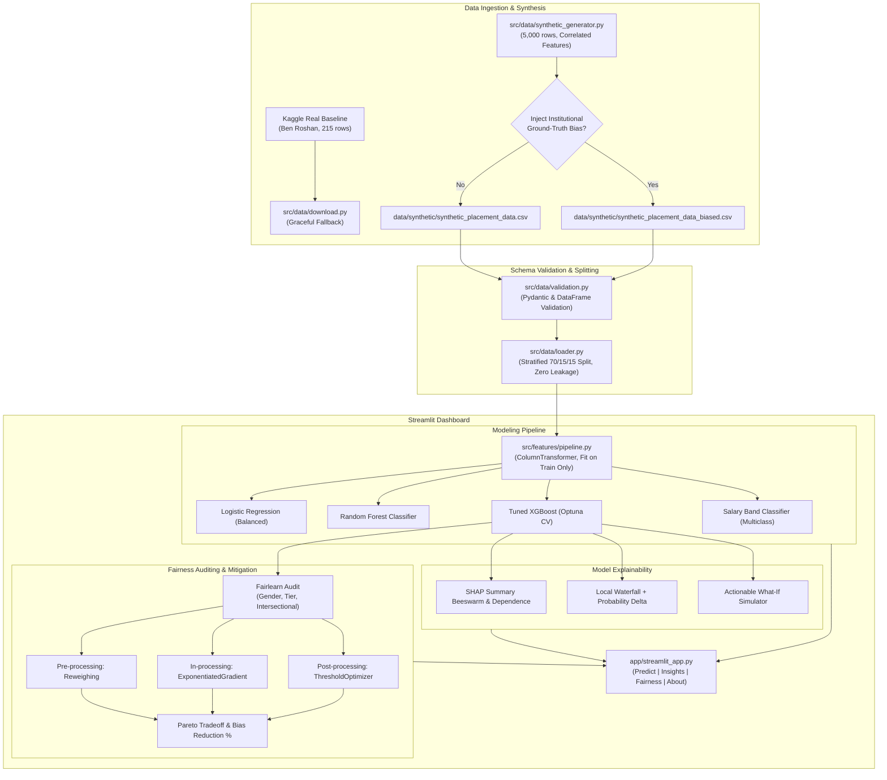

# Campus Placement Predictor with Explainability and Fairness Audit

[](https://github.com/organization/placement-predictor/actions/workflows/ci.yml)
[](https://www.python.org/)
[](LICENSE)
[](https://github.com/psf/black)
[](https://github.com/astral-sh/ruff)

An end-to-end, production-grade Machine Learning system that predicts college campus placement outcomes, explains individual predictions via SHAP, audits models for demographic bias across gender and college tier using Fairlearn, applies bias mitigation algorithms, and serves results in an interactive Streamlit application.

---

## 1. System Architecture



---

## 2. Data Strategy & Provenance

For thorough transparency, the data strategy is divided into two transparent components (detailed in [DATA_CARD.md](DATA_CARD.md)):
- **Real Baseline Dataset**: Kaggle *Campus Recruitment* dataset (Ben Roshan, 215 rows). Provides historic baseline context.
- **Production-Scale Synthetic Dataset**: A 5,000-row dataset generated by `src/data/synthetic_generator.py` with realistic correlations between academic metrics (CGPA, 10th/12th %), technical skills (DSA problems solved, projects, hackathons), internships, communication, aptitude, branch, and college tier.
- **Ground-Truth Bias Injection**: The generator supports an optional, auditable bias parameter (`--inject-bias`) that imposes deliberate institutional penalties on Tier-3 college students and Female candidates. This provides a known ground truth for the Fairlearn audit to evaluate before and after mitigation.

> [!WARNING]
> **Synthetic Data Disclaimer**: Synthetic data results are mathematical simulations designed for ML engineering and algorithmic auditing. They do not represent real-world recruitment decisions.

---

## 3. Repository Structure

```
placement-predictor/
├── README.md                          # Project overview, architecture, quickstart
├── DATA_CARD.md                       # Comprehensive data provenance & generator specification
├── MODEL_CARD.md                      # Intended use, architecture, fairness design
├── LICENSE                            # MIT License
├── requirements.txt                   # Pinned production dependencies
├── pyproject.toml                     # Ruff, Black, pytest, and package metadata
├── Makefile                           # GNU Make automation targets
├── make.ps1                           # Native Windows PowerShell task runner
├── .gitignore                         # Git exclusion rules
├── .pre-commit-config.yaml            # Pre-commit formatting and lint hooks
├── .github/workflows/ci.yml           # GitHub Actions CI workflow (lint + test)
├── config/
│   ├── config.yaml                    # Master project, paths, and modeling configuration
│   └── synth_config.yaml              # Synthetic generation and bias parameters
├── data/
│   ├── download_data.py               # Kaggle real dataset downloader script
│   ├── raw/                           # Raw downloaded Kaggle datasets
│   ├── processed/                     # Train/val/test preprocessed datasets
│   └── synthetic/                     # Generated unbiased and biased datasets
├── notebooks/                         # Exploratory analysis and modeling notebooks
│   ├── 01_eda.ipynb
│   ├── 02_modeling.ipynb
│   ├── 03_explainability.ipynb
│   └── 04_fairness_audit.ipynb
├── src/
│   ├── data/                          # Download, synthetic generator, loader, schema validation
│   ├── features/                      # Preprocessing pipeline and encoders
│   ├── models/                        # Training, Optuna tuning, evaluation, predict, registry
│   ├── explainability/                # SHAP global, SHAP local, what-if counterfactuals
│   ├── fairness/                      # Fairlearn metrics, audit engine, mitigation strategies
│   └── utils/                         # Standardized logger, YAML config loader, seeding
├── app/                               # Streamlit interactive application
│   ├── streamlit_app.py               # Multi-page dashboard entrypoint
│   ├── pages/                         # Predictor, Model Insights, Fairness Dashboard, About
│   └── components/                    # Reusable UI widgets and charting components
├── reports/
│   ├── figures/                       # Generated SHAP and Fairness trade-off plots
│   ├── fairness_report.md             # Automated markdown fairness audit report
│   └── metrics.json                   # Machine-readable evaluation results
├── models/                            # Serialized joblib pipelines and metadata
└── tests/                             # Unit and integration test suite
```

---

## 4. Quickstart & Execution

### Option A: Using `make` (Linux / macOS / WSL)
```bash
# 1. Environment Setup
make setup

# 2. Data Generation (Unbiased & Biased datasets)
make data

# 3. Train & Evaluate Models (Phase 2)
make train

# 4. Run Fairness Audit & Mitigation (Phase 4)
make audit

# 5. Launch Streamlit UI (Phase 5)
make app

# 6. Run Test Suite with Coverage
make test

# 7. Run Linters
make lint
```

### Option B: Using PowerShell `.\make.ps1` (Windows Native)
```powershell
# 1. Environment Setup
.\make.ps1 setup

# 2. Data Generation
.\make.ps1 data

# 3. Train Models
.\make.ps1 train

# 4. Fairness Audit
.\make.ps1 audit

# 5. Launch Streamlit UI
.\make.ps1 app

# 6. Run Tests
.\make.ps1 test

# 7. Run Linters
.\make.ps1 lint
```

---

## 5. Implementation Status

| Phase | Description | Status |
| :--- | :--- | :---: |
| **Phase 1: Foundations** | Repo scaffold, config system, logging, seeding, data loader, Pydantic validation, synthetic generator with bias injection, CI workflow | **COMPLETED** |
| **Phase 2: EDA & Modeling** | EDA notebook, non-leaking ColumnTransformer pipeline, Logistic Regression, Random Forest, Optuna-tuned XGBoost, Salary Classifier, Model Registry | **COMPLETED** |
| **Phase 3: Explainability** | Global SHAP beeswarm/importance, local waterfall plots with calibrated probability conversion, what-if counterfactual simulator | **COMPLETED** |
| **Phase 4: Fairness & Mitigation** | Fairlearn audit across gender and tier, unawareness proxy test, Reweighing, ExponentiatedGradient, ThresholdOptimizer, Pareto trade-off | **COMPLETED** |
| **Phase 5: Streamlit App** | 4-page UI: Prediction & What-if, Model Insights, Fairness Dashboard, About & Data Card with dark glassmorphism design system | **COMPLETED** |
| **Phase 6: Quality & Delivery** | 47 unit tests (80.4% coverage), Dockerfile & docker-compose, complete metrics in `reports/metrics.json`, documentation verification | **COMPLETED** |

---

## 6. Docker Deployment

Launch the entire containerized application with a single command:

```bash
# Build and run containerized Streamlit application
docker-compose up --build -d

# Check container health and logs
docker-compose logs -f

# Access the application
# URL: http://localhost:8501
```

---

## 7. Verified Performance & Fairness Benchmarks

### Placement Classification (Held-Out Test Set, N=750)
- **Tuned XGBoost**: Test Accuracy = **89.60%**, ROC-AUC = **0.8735**, PR-AUC = **0.9762**, F1 = **0.9416**, Brier Score = **0.0773**.
- **Random Forest**: Test Accuracy = 85.33%, ROC-AUC = 0.8755, PR-AUC = 0.9762, F1 = 0.9126.
- **Logistic Regression**: Test Accuracy = 81.87%, ROC-AUC = 0.8926, PR-AUC = 0.9801, F1 = 0.8872.

### Algorithmic Fairness Benchmark (College Tier)
- **Baseline (Aware)**: Accuracy = 80.8%, DP Gap = 0.071, Bias Reduction = +0.0%
- **Unawareness (Blind)**: Accuracy = 84.3%, DP Gap = 0.020, Bias Reduction = +72.2% (proxy reconstruction)
- **Mitigated (Reweighing)**: Accuracy = **85.5%**, DP Gap = **0.027**, Bias Reduction = **+62.1%**
- **Mitigated (ThresholdOptimizer)**: Accuracy = 84.8%, DP Gap = 0.078, Bias Reduction = -10.6%
- **Mitigated (ExponentiatedGradient)**: Accuracy = 80.0%, DP Gap = 0.067, Bias Reduction = +5.9%

$$\text{Bias Reduction \%} = \frac{\text{DP\_Diff}_{\text{baseline}} - \text{DP\_Diff}_{\text{mitigated}}}{\text{DP\_Diff}_{\text{baseline}}} \times 100\%$$

