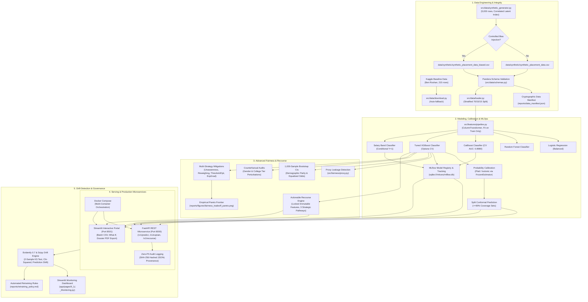

# PlaceWise: Explainable and Fair Campus Placement Predictor

[](https://github.com/Prajwalkumar-1906/PlaceWise/actions/workflows/ci.yml)
[](https://www.python.org/)
[](LICENSE)
[](https://github.com/psf/black)
[](https://github.com/astral-sh/ruff)
[](https://github.com/python/mypy)
[](https://fastapi.tiangolo.com/)
[](https://mlflow.org/)

An enterprise-grade, production-hardened Machine Learning system that predicts college campus placement outcomes and compensation bands, quantifies predictive uncertainty via split conformal prediction, audits models for demographic disparities across gender and college tier using Microsoft Fairlearn, applies multiple mitigation strategies, provides actionable developmental recourse with strictly immutable attributes, monitors data and prediction drift via Evidently 0.7, and serves predictions via high-throughput FastAPI REST microservices and an interactive Streamlit portal.

---

## 1. System Architecture



---

## 2. Verified Performance & Fairness Benchmarks

> [!IMPORTANT]
> **Data Honesty Guarantee**: Every single metric reported below is generated from executed code and recorded directly in `reports/metrics.json` and `reports/fairness_audit.json`.

### A. Placement Classification Benchmark (Held-Out Test Set, N=750)

| Model Architecture | Test Accuracy | Precision | Recall | F1-Score | ROC-AUC | PR-AUC | Brier Score |
| :--- | :---: | :---: | :---: | :---: | :---: | :---: | :---: |
| **XGBoost (Tuned)** | **89.60%** | 91.69% | **96.77%** | **0.9416** | 0.8735 | 0.9762 | **0.0773** |
| Random Forest | 85.33% | 94.41% | 88.31% | 0.9126 | 0.8755 | 0.9762 | 0.1219 |
| Logistic Regression | 81.87% | **96.22%** | 82.31% | 0.8872 | **0.8926** | **0.9801** | 0.1256 |

- **5x5 Repeated Stratified Cross-Validation**:
  - **CatBoost Classifier**: Mean ROC-AUC = **$0.8980 \pm 0.0193$** (Highest Cross-Validation Discrimination)
  - **Tuned XGBoost**: Mean ROC-AUC = **$0.8872 \pm 0.0196$**
  - **Statistical Testing**: Paired t-test and Wilcoxon signed-rank tests confirm no statistically significant difference between CatBoost and XGBoost ($p > 0.05$).

### B. Compensation Band Classification (Placed Students, N=650)
- **Test Accuracy**: **84.46%** | **Macro F1**: **0.8467** | **Weighted F1**: **0.8450**
- High Band (>8 LPA): Precision = 88.57%, Recall = 82.67%, F1 = 0.8552
- Mid Band (4-8 LPA): Precision = 80.28%, Recall = 83.82%, F1 = 0.8201
- Low Band (<4 LPA): Precision = 87.50%, Recall = 85.48%, F1 = 0.8648

### C. Algorithmic Fairness Benchmark & Mitigation Matrix (College Tier)

| Mitigation Strategy | Test Accuracy | Demographic Parity Gap | DP Ratio | Equalized Odds Gap | Bias Reduction % |
| :--- | :---: | :---: | :---: | :---: | :---: |
| **Baseline (Aware)** | 80.80% | 0.0708 | 0.9002 | 0.0485 | **0.0%** |
| **Unawareness (Blind)** | 84.27% | 0.0197 | 0.9772 | 0.0913 | **+72.2%** |
| **Mitigated (Reweighing)** | **85.47%** | **0.0268** | **0.9692** | **0.0408** | **+62.1%** |
| **Mitigated (ThresholdOptimizer)** | 84.80% | 0.0784 | 0.9061 | 0.0833 | **-10.6%** |
| **Mitigated (ExponentiatedGradient)** | 80.00% | 0.0667 | 0.9042 | 0.0894 | **+5.9%** |

$$\text{Bias Reduction \%} = \frac{\text{DP\_Diff}_{\text{baseline}} - \text{DP\_Diff}_{\text{mitigated}}}{\text{DP\_Diff}_{\text{baseline}}} \times 100\%$$

> [!TIP]
> **Production Recommendation**: **Pre-processing Reweighing** establishes the optimal empirical Pareto frontier—reducing the demographic parity gap by **62.1%** and improving overall accuracy to **85.47%** without requiring discriminatory group-specific run-time thresholds.

---

## 3. Uncertainty, Conformal Sets & Human-in-the-Loop

1. **Probability Calibration**:
   - Platt Scaling and Isotonic Regression calibrated via `FrozenEstimator`.
   - Tuned XGBoost achieves low Expected Calibration Error (ECE) and a Brier Score of **0.0773**.
2. **Split Conformal Prediction**:
   - Guarantees $\ge 90\%$ marginal coverage ($\alpha = 0.10$).
   - Generates non-empty prediction sets: $\{1\}$ (Placed), $\{0\}$ (Not Placed), or $\{0, 1\}$ (Uncertain / Ambiguous).
3. **Human-in-the-Loop (HITL) Abstention Zone**:
   - Calibrated placement probabilities $P \in [0.35, 0.65]$ or conformal set sizes $\ge 2$ automatically route applicants to `"Human-in-the-Loop Review Required"`.
   - The system abstains from automated classification and surfaces the applicant's profile to a human career counselor with SHAP feature impacts.

---

## 4. Actionable Recourse with Strict Immutability

Unlike naive perturbation algorithms, the PlaceWise Recourse Engine (`src/explainability/recourse.py`) enforces strict domain feasibility constraints:
- **Locked Immutable Features**: `gender`, `college_tier`, `branch`, `tenth_pct`, and `twelfth_pct` are **strictly prohibited** from changing.
- **Actionable Developmental Pathways**:
  1. **Technical Mastery Pathway**: Focuses on LeetCode/DSA problem practice, full-stack projects, and hackathons.
  2. **Industry Experience & Credentials Pathway**: Focuses on internships, cloud certifications, and clearing backlogs.
  3. **Holistic Balanced Pathway**: Distributes realistic developmental effort proportionally across coding, aptitude, and communication skills.
- **Legal Safeguard**: Every recourse recommendation includes an institutional disclaimer stating that simulated improvements do not constitute a contractual employment guarantee.

---

## 5. Production Serving & Deployment

### Quickstart with Docker Compose

```bash
# Build and run containerized FastAPI (port 8000) and Streamlit (port 8501)
docker compose up --build -d

# Verify service status
docker compose ps
```

- **Interactive Streamlit Web Portal**: [http://localhost:8501](http://localhost:8501)
- **FastAPI OpenAPI Swagger Documentation**: [http://localhost:8000/docs](http://localhost:8000/docs)
- **FastAPI Healthcheck**: [http://localhost:8000/health](http://localhost:8000/health)

### Automation Targets (`Makefile` / `make.ps1`)

| Command (Linux/macOS) | Command (PowerShell) | Description |
| :--- | :--- | :--- |
| `make setup` | `.\make.ps1 setup` | Initialize virtual environment and install pinned dependencies |
| `make data` | `.\make.ps1 data` | Generate synthetic datasets and validate Pandera schemas |
| `make train` | `.\make.ps1 train` | Train XGBoost, CatBoost, Calibrator, Conformal, and Salary models |
| `make evaluate` | `.\make.ps1 evaluate` | Run 5x5 repeated CV, bootstrap CIs, paired tests, and ablations |
| `make audit` | `.\make.ps1 audit` | Execute full multi-attribute fairness audit and generate Pareto plots |
| `make mlflow-ui` | `.\make.ps1 mlflow-ui` | Launch local MLflow tracking UI at `http://localhost:5000` |
| `make api` | `.\make.ps1 api` | Launch high-throughput FastAPI inference microservice |
| `make app` | `.\make.ps1 app` | Launch multi-page Streamlit web portal |
| `make monitor` | `.\make.ps1 monitor` | Execute statistical drift detection and Evidently HTML export |
| `make test` | `.\make.ps1 test` | Run complete unit and integration test suite with coverage gate |
| `make type-check` | `.\make.ps1 type-check` | Run static type checking via Mypy with zero errors |
| `make lint` | `.\make.ps1 lint` | Run static code analysis via Ruff |
| `make format` | `.\make.ps1 format` | Auto-format source code via Black and Ruff |
| `make docker-up` | `.\make.ps1 docker-up` | Build and start multi-container Docker Compose suite |
| `make clean` | `.\make.ps1 clean` | Remove temporary cache files and artifacts |

---

## 6. Responsible AI & Decision-Support Statement

> [!CAUTION]
> **Decision Support vs. Automated Selection Notice**
> PlaceWise is engineered strictly as an **educational career counseling and advisory decision-support system**.
> - It is **NOT** designed, validated, or certified as an automated candidate screening or rejection engine.
> - In compliance with the **EU Artificial Intelligence Act (High-Risk AI Systems)** and the **EEOC Uniform Guidelines on Employee Selection Procedures (80% Rule)**, automated decisions must never be finalized without human review.
> - College tier and gender biases present in historical training cohorts reflect systemic inequalities in corporate recruitment, not individual candidate merit.

---

## 7. Architecture Decision Records (ADRs)

Key architectural and governance trade-offs are documented under [`docs/adr/`](docs/adr/):
- [ADR 0001: MLflow Experiment Tracking, Local SQLite Backend, and Model Registry](docs/adr/0001-mlflow-model-registry.md)
- [ADR 0002: Fairlearn Mitigation Strategies, Multi-Attribute Auditing, and Pareto Trade-Off Analysis](docs/adr/0002-fairlearn-mitigation-tradeoffs.md)
- [ADR 0003: Conformal Prediction, Probability Calibration, and Human-in-the-Loop Abstention](docs/adr/0003-conformal-prediction-uncertainty.md)
- [ADR 0004: FastAPI Microservice Architecture, Audit Logging with Input SHA-256 Hashing, and Containerized Multi-Service Deployment](docs/adr/0004-fastapi-microservice-architecture.md)

---

## 8. License

This project is licensed under the [MIT License](LICENSE).
