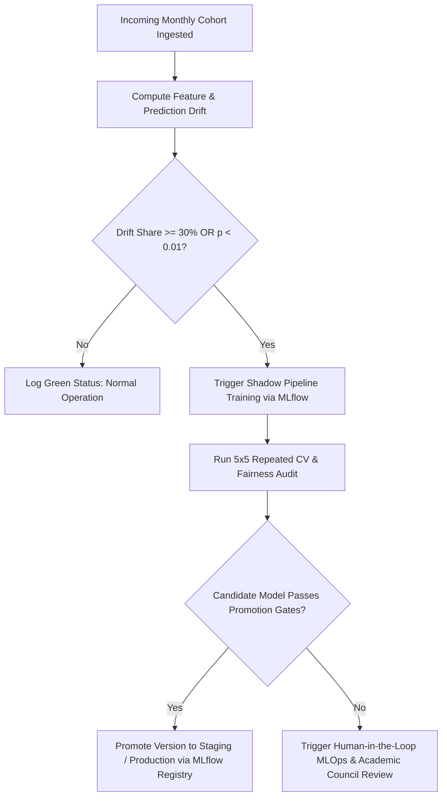

# Model Governance & Automated Retraining Trigger Policy

## 1. Overview & Policy Objective
In high-stakes educational decision support, algorithmic models decay due to shifting grading norms, macroeconomic hiring trends, and institutional demographic dynamics.
This document defines the formal **Operational Retraining Policy** for the PlaceWise Campus Placement Prediction system.
It establishes mathematical trigger conditions that distinguish natural statistical fluctuations from systemic covariate or concept shift.

---

## 2. Trigger Hierarchy & Decision Matrix

| Dimension | Primary Metric | Statistical Test | Alert Level | Critical Retrain Threshold |
| :--- | :--- | :--- | :---: | :---: |
| **Covariate Drift (Features)** | Drift Share | 2-Sample KS test / $\chi^2$ ($p < 0.05$) | $\ge 20\%$ | **$\ge 30\%$ of features** |
| **Concept Drift (Outputs)** | Prediction Probabilities | 2-Sample Kolmogorov-Smirnov | $p < 0.05$ | **$p < 0.01$** |
| **Model Discrimination** | Held-Out Test Accuracy | Rolling 30-Day Evaluation | $\Delta \text{Acc} > 3\%$ | **$\Delta \text{Acc} > 5.0\%$** |
| **Model Calibration** | Brier Score Loss | Brier Score Gap | $\Delta \text{Brier} > 0.02$ | **$\Delta \text{Brier} > 0.030$** |
| **Algorithmic Fairness** | Demographic Parity Gap | Fairlearn Audit ($\text{Tier}_1 - \text{Tier}_3$) | $\text{Gap} > 0.08$ | **$\text{Gap} > 0.100$** |

---

## 3. Mathematical Definitions

### A. Covariate Drift Share
$$\text{Drift Share} = \frac{1}{K} \sum_{k=1}^K \mathbb{I}\left( p\text{-value}_k < \alpha \right)$$
where $\alpha = 0.05$ and $K$ is the total count of active model features (11 continuous, 4 categorical).
- Continuous features are tested via the 2-sample Kolmogorov-Smirnov statistic:
  $$D = \sup_x |F_{\text{ref}}(x) - F_{\text{current}}(x)|$$
- Categorical features are tested via Pearson's Chi-squared contingency statistic:
  $$\chi^2 = \sum \frac{(O - E)^2}{E}$$

### B. Output Probability Shift
$$D_{\text{pred}} = \sup_p |G_{\text{ref}}(P(Y=1|X)) - G_{\text{current}}(P(Y=1|X))|$$
If $p\text{-value}(D_{\text{pred}}) < 0.01$, a statistically significant shift in model decision confidence has occurred.

---

## 4. Operational Escalation Protocol

### Protocol Steps:
1. **Automated Drift Detection**: The monthly ingestion pipeline executes `make monitor` against the baseline training cohort.
2. **Automated Shadow Run**: If a trigger is breached, an automated background job trains a fresh candidate model on merged historical and recent data.
3. **Fairness & Calibration Gate**:
   - The newly trained model must satisfy:
     - ROC-AUC $\ge 0.85$
     - F1 Score $\ge 0.88$
     - Brier Score $\le 0.12$
     - Demographic Parity Gap $\le 0.10$
4. **Human Sign-off**: Before transitioning from Staging to Production, academic administration verifies disaggregated sub-group selection rates.
